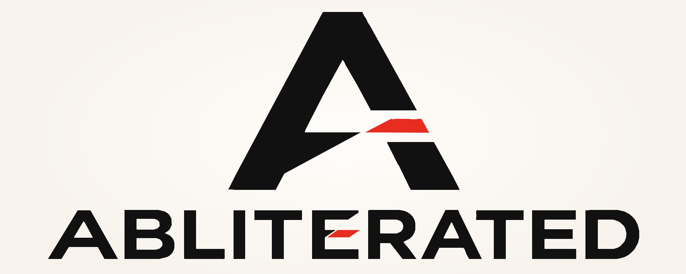

  

<h1 align="center">ABLITERATED</h1>

  <strong>Sprachmodelle gezielt anpassen. Ergebnisse nachvollziehbar bereitstellen.</strong>

  <strong>Ein Produkt von WIMAEDV IT-Forensik und Systemservice.</strong>

  
  

## Über ABLITERATED

ABLITERATED entsteht als webbasierte Anwendung für die gezielte Abliteration kompatibler Sprachmodelle. Sie soll eine verständliche Modellwahl, konfigurierbare Verarbeitung und überprüfbare Ergebnisbereitstellung miteinander verbinden.

Das Produkt berücksichtigt sowohl kompakte als auch große Sprachmodelle. Welche Modelle tatsächlich unterstützt werden, hängt unter anderem von Architektur, Gewichtsdarstellung und verfügbaren Rechenressourcen ab.

## Vorgesehene Produktfunktionen

- **Modellwahl:** Geeignete Sprachmodelle auswählen und ihre technische Kompatibilität prüfen.
- **Konfiguration:** Verfahren und wesentliche Parameter anpassen.
- **Verarbeitung:** Modellaufträge über eine Weboberfläche starten und ihren tatsächlichen Status verfolgen.
- **Verifikation:** Ergebnisse auf technische Verwendbarkeit und dokumentierte Veränderungen prüfen.
- **Bereitstellung:** Kompatible, überprüfte Modellartefakte in unterstützten Formaten abrufen.

Diese Punkte beschreiben den **geplanten Funktionsumfang**, nicht bereits verfügbare Software.

## Projektstatus

ABLITERATED befindet sich in der Entwicklung. Derzeit wird hier weder eine öffentliche Anwendung noch eine ausführbare Produktversion angeboten. Funktionsumfang, Modellunterstützung und Verfügbarkeit werden erst mit überprüfbaren Releases verbindlich ausgewiesen.

## Projektträger

**WIMAEDV IT-Forensik und Systemservice**

ABLITERATED ist ein Produkt von WIMAEDV und keine rechtlich eigenständige Gesellschaft.

## Dieses Repository

Dieses Repository dient ausschließlich der **öffentlichen Produktpräsentation** und später ausdrücklich freigegebener Veröffentlichungen. Aus der öffentlichen Sichtbarkeit dieses Repositorys folgt keine Lizenz zur Weiterverwendung von Marken, Grafiken oder künftigen Softwarekomponenten.

Interne Entwicklungsmaterialien sind nicht Bestandteil dieses Repositorys.
